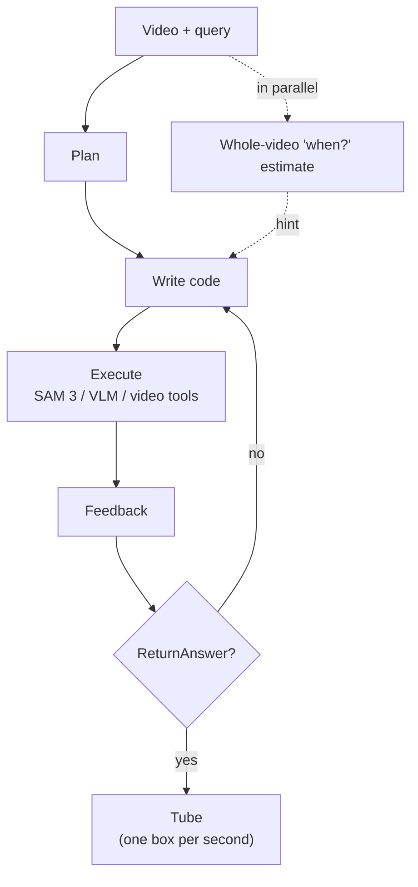

<div align="center">

# STVG Agent

### A training-free code-as-action agent for spatio-temporal video grounding

**_A VLM writes and runs Python, calls SAM 3 for tracking, and returns a spatio-temporal tube._**

</div>

---

> **TL;DR.** STVG Agent is a **training-free** agent for **spatio-temporal video grounding (STVG)** on
> [AnyGroundBench](https://github.com/rinost081/anygroundbench). A single open model, **Qwen3.5-9B**, plans, then writes one
> Python cell per step into a persistent Jupyter kernel pre-loaded with SAM 3 tracking, VLM queries and video / drawing tools,
> and commits with `ReturnAnswer(...)`. Its spatial accuracy (v_IoU) on Animal, Industry and Public Security is above the best
> published numbers of the 23 models in the AnyGroundBench paper, with the same prompts and hyper-parameters for every domain.

> 🔍 **What this repo contains.** The agent runtime (workflow, persistent Jupyter kernel with an AST safety check, planning
> prompt, temporal estimate `when()`), the SAM 3 + embedding tool server, vLLM / tool-server launch scripts, evaluation and
> visualization scripts, and the summary metrics of the best configuration: a sighted planner, the whole-video clip and a
> whole-video "when?" estimate as a hint, and timestamps on still frames. `scripts/run_agent.sh` runs it.
> The agent loop is ported from [SpatialClaw](https://github.com/NVlabs/SpatialClaw); video input, the temporal tools and the
> STVG-specific prompts are added.

---

## Results

All queries of each domain (number of queries in parentheses), 1 fps. Cells are m_tIoU / m_vIoU / vIoU@0.3 / vIoU@0.5 (%).
**Bold** is the best and <ins>underline</ins> the second best in each column of this table (zeros are not marked).

| Method | Animal (157) | Industry (169) | Sports (163) | Surgery (216) | Public Security (250) |
|---|---|---|---|---|---|
| Qwen3.5-9B † | 24.6 / 4.33 / 4.46 / 0.64 | 9.05 / 1.07 / 0.59 / 0.00 | 14.1 / 0.22 / 0.61 / 0.00 | 13.2 / 0.74 / 0.00 / 0.00 | 32.1 / 1.32 / 0.40 / 0.00 |
| GPT-6-Astra † | 23.3 / <ins>17.5</ins> / <ins>19.1</ins> / <ins>10.2</ins> | 11.8 / 5.93 / 7.10 / <ins>2.37</ins> | 17.3 / **5.12** / **4.91** / **0.61** | **31.1** / **18.3** / **25.9** / **11.1** | 36.7 / <ins>19.4</ins> / 18.8 / 3.20 |
| Gemini-2.5-Pro † | 23.6 / 8.44 / 8.28 / 3.18 | <ins>21.8</ins> / 1.92 / 1.18 / 0.00 | **35.4** / 2.17 / 0.61 / **0.61** | <ins>22.6</ins> / 3.66 / 1.39 / 0.00 | <ins>40.5</ins> / 8.66 / 4.00 / 0.80 |
| Gemini-3.1-Pro † | <ins>29.1</ins> / 12.9 / 16.6 / 6.37 | 19.7 / <ins>6.22</ins> / <ins>7.69</ins> / <ins>2.37</ins> | <ins>31.2</ins> / <ins>3.26</ins> / <ins>1.23</ins> / 0.00 | 19.0 / <ins>6.55</ins> / 4.17 / 0.46 | <ins>40.5</ins> / 17.0 / <ins>22.8</ins> / <ins>4.40</ins> |
| **Ours: STVG Agent (Qwen3.5-9B)** | **29.8** / **24.4** / **35.0** / **22.3** | **22.1** / **10.4** / **13.0** / **7.7** | 24.7 / 1.5 / 0.6 / 0.0 | 21.0 / 5.4 / <ins>6.0</ins> / <ins>0.9</ins> | **43.5** / **23.9** / **38.4** / **18.0** |
| Δ vs. Qwen3.5-9B | +5.2 / +20.1 / +30.5 / +21.7 | +13.1 / +9.3 / +12.4 / +7.7 | +10.6 / +1.3 / 0.0 / 0.0 | +7.8 / +4.7 / +6.0 / +0.9 | +11.4 / +22.6 / +38.0 / +18.0 |

Δ = Ours − Qwen3.5-9B (the same model without tools), in points.

† Results reported in the [AnyGroundBench paper](https://arxiv.org/abs/2607.02269), which lists all 23 models. Ours is our own
run, scored with the same evaluation code.

---

## How it works

The agent repeats **think → write Python → run it and look at the result** for up to 30 steps and finishes with
`ReturnAnswer(...)`, a tube (one box per second). The code runs in a Jupyter kernel started fresh for each query; variables
persist across steps. Inside the code the agent calls SAM 3 (detect / track), other VLM queries and video / drawing tools.



At runtime three processes cooperate: a **vLLM server** (Qwen3.5-9B for every LLM role), a **GPU tool server**
(SAM 3 and Qwen3-VL-Embedding) and the **agent** (one Jupyter kernel per worker).

➡ Full details: **[docs/architecture.md](docs/architecture.md)**

---

## Example

*"The great egret makes a landing."* (Animal, ground truth 0.9–6.3 s of an 18-second video). Ground truth in green,
prediction in red. More examples, with the agent's steps and where it fails, are in **[docs/examples.md](docs/examples.md)**.


Qwen3.5-9B in a single pass answers 0–17 s with a small box in the air above the bird (t_IoU 0.33, v_IoU 0.01). The agent
(6 steps):

1. **Plan**: from the key frames the planner reads the sequence (descending at 0–1 s, in the water at 2 s, standing from 3 s,
   taking off at 12–17 s), so the landing is at the start of the video.
2. **Watch** the first seconds: `tools.Video.clip(start_frame=0, end_frame=91, fps=2)` and `show(clip)`.
3. **Track** the bird with SAM 3: `tools.SAM3.segment_video_by_text("great egret")`, and check the boxes at 0, 2 and 4 s.
4. **Check the end** of the landing with `tools.Draw.tube(...)` clips of 3–6 s and 4–6 s.
5. **Submit** `ReturnAnswer(egret_tube, object=0, start_frame=0, end_frame=180)`: t_IoU 0.86, v_IoU 0.75.

---

## Quickstart

**1. Install** — creates the four environments under `envs/` and downloads the model weights (about 20 minutes).
Log in to Hugging Face first and accept the license of [`facebook/sam3`](https://huggingface.co/facebook/sam3).

```bash
git clone https://github.com/Fujiry0/stvg-agent.git && cd stvg-agent
uvx --from huggingface_hub hf auth login
bash scripts/setup.sh
```

**2. Data** — put [AnyGroundBench](https://huggingface.co/datasets/rinost081/AnyGroundBench) under `data/` in the
repository root (a symlink works), so that `data/animal/meta-data/st_test.json` and `data/animal/videos/clips/*.mp4`
exist. How to obtain the videos: [docs/installation.md](docs/installation.md#data).

**3. Start the servers** (vLLM, then the tool server and its watchdog):

```bash
mkdir -p logs
scripts/serve_vllm.sh > logs/vllm.log 2>&1 &
scripts/restart_tools.sh
setsid nohup scripts/tools_watchdog.sh > /dev/null 2>&1 &
```

**4. Run and evaluate:**

```bash
# a quick check on two queries
scripts/run_agent.sh --run_name demo --query_ids test_0 test_85 --concurrency 3
scripts/eval_st.sh --subset demo results/agent/demo/spatio_temporal/demo_animal.json

# the whole domain (all 157 Animal queries): no --query_ids, no --subset
scripts/run_agent.sh --run_name full --concurrency 5
scripts/eval_st.sh full results/agent/full/spatio_temporal/full_animal.json
```

Without `--query_ids` the agent runs every query of the domain (`--domain`, default `animal`); `--max_samples N` limits it
to the first N, `--resume` skips queries that are already in `predictions.jsonl`. `--subset` scores only the queries that
were run; without it, queries that were not run count as failures (full-domain numbers).

**Zero-shot (the same model without tools).** With vLLM up, one call of Qwen3.5-9B per query over the video at 1 fps, up to
32 frames, then the same evaluation:

```bash
scripts/run_zeroshot.sh animal                       # or: animal industry sports surgery safety
# -> results/eval/zeroshot_animal/ (metrics, per_query/, per_query_files/)
```

This is the single pass shown next to the agent in [docs/examples.md](docs/examples.md). The paper's zero-shot numbers
(120 frames, Hugging Face `generate`) come from AnyGroundBench's own `test.py`, see
[its README](https://github.com/rinost081/anygroundbench).

`scripts/run_domains.sh` runs the other domains (industry, sports, safety, surgery) and evaluates. Per-query files and
videos with the ground truth (green) and the prediction (red):

```bash
python3 scripts/split_per_query.py --per_query results/eval/demo/per_query/demo_animal_with_per_query_metrics_spatio_temporal.json \
    --tubes data/animal/vidi_eval/results/demo_spatio_temporal/tubes.csv --out_dir results/eval/demo/per_query_files
envs/agent/.venv/bin/python scripts/visualize_st.py --per_query_dir results/eval/demo/per_query_files \
    --query_ids test_0 test_85 --out_dir results/eval/demo/vis
```

## Layout

```text
stvg_agent/    the agent: workflow.py (loop), run.py (parallel runner), config.py, tools_server.py (SAM 3 + embeddings),
               temporal_select.py (the whole-video "when?" anchor), llm/, kernel/, kernel_types/, tools/
configs/model/ sampling settings per role (qwen3.5-9b.json)
baselines/    single_pass_vllm.py: the same model in a single pass, without tools (zero-shot)
scripts/       servers, runner, evaluation, visualization
docs/          architecture.md: how the agent works
results/       evaluation outputs of the best configuration
third_party/   vendored AnyGroundBench (evaluation code, published predictions); see third_party/anygroundbench/VENDORED.md
```

---

## Documentation

| Guide | Contents |
|-------|----------|
| 📦 [Installation](docs/installation.md) | Prerequisites, the four environments, model weights, host settings |
| 🔍 [Examples](docs/examples.md) | Runs next to a single pass of the same model, with the agent's steps and where it fails |
| ⚠️ [Limitations](docs/limitation.md) | Runtime, short events, tracking in crowded scenes, and other known weaknesses |
| 🧠 [Architecture](docs/architecture.md) | The agent loop, hyper-parameters, LLM sessions, tools in the kernel, runtime layout |

---

## Citation

If you use this code, please cite the benchmark and SpatialClaw:

```bibtex
@misc{otsubo2026anygroundbenchspecializeddomainbenchmarkvideo,
  title         = {AnyGroundBench: A Specialized-Domain Benchmark for Video Grounding in Vision-Language Models},
  author        = {Rintaro Otsubo and Ryo Fujii and Reina Ishikawa and Taiki Kanaya and Kanta Sawafuji and
                   Hiroki Kajita and Shigeki Sakai and Hideo Saito and Ryo Hachiuma},
  year          = {2026},
  eprint        = {2607.02269},
  archivePrefix = {arXiv},
  primaryClass  = {cs.CV},
  url           = {https://arxiv.org/abs/2607.02269}
}

@inproceedings{
Cho2026SpatialClaw,
title={{SpatialClaw: Rethinking Action Interface for Agentic Spatial Reasoning}},
author={Seokju Cho and Ryo Hachiuma and Abhishek Badki and Hang Su and Byung-Kwan Lee and Chan Hee Song and Sifei Liu and Subhashree Radhakrishnan and Seungryong Kim and Yu-Chiang Frank Wang and Min-Hung Chen},
booktitle={NeurIPS},
year={2026},
}
```

## Licenses

This is not an official NVIDIA release. The repository contains code ported from
[SpatialClaw](https://github.com/NVlabs/SpatialClaw) (Copyright © 2026, NVIDIA Corporation), which is distributed under
the **NVIDIA Source Code License-NC** (non-commercial scientific research use only); the whole repository is made available
under the same license, see [LICENSE](LICENSE). The NVIDIA copyright notices are kept unchanged; the modifications and
additions are Copyright © 2026 Ryo Fujii and are made available under the same license.

| Component | Terms |
|---|---|
| This repository's code | NVIDIA Source Code License-NC ([LICENSE](LICENSE)) |
| `third_party/anygroundbench/` | vendored from [AnyGroundBench](https://github.com/rinost081/anygroundbench), under its upstream terms |
| AnyGroundBench data and videos | the newly captured data under CC BY-NC-SA 4.0, the rest under the licenses of the source datasets |
| Model weights (Qwen3.5, Qwen3-VL-Embedding, SAM 3) | their own licenses |

The example figures in [docs/examples.md](docs/examples.md) contain frames of AnyGroundBench videos, which remain under the
licenses of their source datasets.
