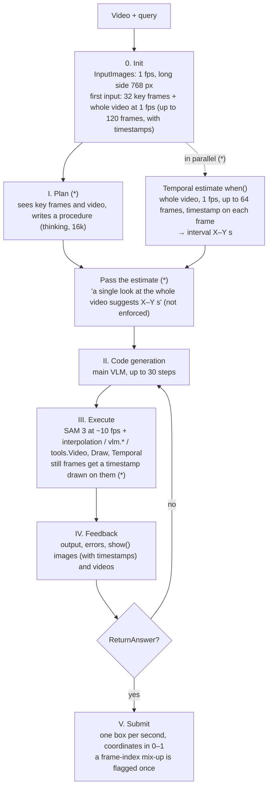

# Architecture

How the agent works: the loop, the hyper-parameters, the LLM sessions, what each stage does, what the agent can use in
the kernel, and the runtime layout.

## The loop

The agent repeats **think → write Python → run it and look at the result** for up to 30 steps and finishes with
`ReturnAnswer(...)`, a tube (one box per second). The code runs in a Jupyter kernel started fresh for each query; variables
persist across steps. Inside the code the agent calls SAM 3 (detect / track), other VLM queries and video / drawing tools.
`(*)` marks what is added or changed relative to [SpatialClaw](https://github.com/NVlabs/SpatialClaw).



Where the time interval is decided: there is no dedicated component. The planner usually writes "ask `when` for the whole
video → check the candidate interval → refine the boundary", and the main VLM does it in code with `vlm.ask_with_thinking`,
`tools.Temporal.refine_boundary` / `relevance` and `tools.Video.clip` + `show()`.

## Hyper-parameters

Defined in `stvg_agent/config.py`, `configs/model/qwen3.5-9b.json` and `scripts/serve_vllm.sh`:

| Stage | Item | Value |
|---|---|---|
| Model | all roles | Qwen3.5-9B (vLLM, max context 262,144 tokens, fp8 KV cache) |
| 0. Init | `InputImages` | 1 fps (each item keeps its original `.frame_index`), long side 768 px |
| | first message | 32 equally spaced key frames + whole-video clip at 1 fps, up to 120 frames, timestamp on each frame |
| Estimate (once, in background) | `temporal_select.when` | 1 fps, up to 64 frames (lower fps for long videos), timestamp at top left, thinking budget 8,192 |
| I. Plan | planner | same first input as the main VLM, thinking budget 16,384, temperature 0.6 |
| II. Code | main VLM | thinking budget 16,384, max_tokens 131,072, temperature 0.6, up to 30 steps |
| III. Execute | cell time limit | 1,200 s (the kernel is reset when exceeded) |
| | kernel memory limit | RSS 24 GB (cell aborted, kernel restarted if memory does not drop) |
| | SAM 3 tracking | every 3rd frame (~10 fps on 30 fps video), linear interpolation in between, up to 1,000 frames per call |
| | `vlm.ask_with_thinking` | up to 64 images per call, thinking budget 8,192, temperature 1.0 / top_p 0.95 / top_k 20 / presence_penalty 1.5 |
| | `vlm.locate` | up to 8 images, thinking budget 4,096 |
| | `tools.Video.clip` / `tools.Draw.tube` | default 1 fps / 2 fps, up to 120 frames |
| | `tools.Temporal.relevance` | Qwen3-VL-Embedding, 1 fps, up to 64 frames |
| IV. Feedback | `show()` | up to 250 images and 30 videos per query |
| V. Submit | tube → evaluation format | one box per second, coordinates in 0–1 |
| Run | concurrency | 5 queries (`scripts/run_domains.sh` uses 2) |

## LLM sessions

All roles are the same Qwen3.5-9B served by vLLM. They differ in what they see and remember: only the main VLM keeps
a conversation; every other call starts from scratch and only its text result returns to the main VLM.

| Session | When | Sees | Returns |
|---|---|---|---|
| **Main VLM** (the agent) | every step | system prompt, 32 key frames, the whole video (1 fps), the plan, earlier code and results, `show()` images | the next step: Purpose / Reasoning / Next Goal / Code |
| Planner (*) | once, at the start | the query, key frames and the whole-video clip | a plan (text); told not to answer |
| Temporal estimate `when()` (*) | once, in the background at the start | the whole video (1 fps, up to 64 frames, each frame labeled with its time) | an interval (start, end in seconds) |
| `vlm.locate` | called from code | up to 8 images and a question | coordinates, or "Not visible" |
| `vlm.ask_with_thinking` | called from code | up to 64 images or video clips and a question | a reasoned text answer |
| `tools.Temporal.refine_boundary` (*) | called from code | the ±3 s neighborhood of a candidate boundary at 5 fps | the boundary time (JSON) |

## Stages

**0. Initialization**
- `InputImages` holds the video sampled at 1 fps; each item keeps its original frame number in `.frame_index` (*).
  SAM 3, clips and drawing read every native frame of the video.
- The first message of the main VLM contains 32 evenly spaced key frames with a table of frame ↔ time, the
  **whole-video clip** (1 fps, up to 120 frames, each frame labeled with its time) (*), and the task instruction
  (the AnyGroundBench STVG prompt).
- A fresh Jupyter kernel is started for the query and the objects below are injected.
- In the background, `when()` makes one call over the whole video.

**I. Plan (*)** — the planner sees the key frames and the clip and writes a procedure: where to look for the event, how to
find the boundaries, how to pick and track the object, and what to verify. It does not answer.

**Estimate hint (*)** — the `when()` result is given to the agent as a message: "a single look at the whole video suggests
X–Y s; it can be wrong, check it before settling on another interval". The answer is never overridden.

**II. Code generation** — the main VLM writes one Python cell per step (Purpose / Reasoning / Next Goal / Code), for up to
30 steps.

**III. Execution** — the cell passes an AST safety check and runs in the kernel; variables persist across steps. A cell has
a 1,200 s limit and the kernel a 24 GB memory cap. Errors are condensed in the conversation and the variables the failed
cell created are rolled back.

**IV. Feedback** — printed output, errors, variable changes, and the images and video clips passed to `show()` are returned
as the next observation. Still frames shown to a VLM or via `show()` carry their time in the top-left corner (*). The
feedback warns once when one step is left.

**V. Submission** — `ReturnAnswer(tube)` is converted to one box per second in the evaluation format (*). Two checks fire at
most once each: a tube of at most 2 s is questioned ("check the seconds before and after"), and a dictionary whose keys
look like `InputImages` list positions instead of frame numbers is rejected (*). If the session ends without an answer,
the last submitted tube is used, or else a single VLM call over the key frames.

## What the agent can use in the kernel

| Name | Content |
|---|---|
| `InputImages` | frames of the video at 1 fps (*); `i` is a list position, `.frame_index` the native frame number |
| `Metadata` | fps, frame count, duration, resolution, video path |
| `show(...)` | put images or video clips into the next observation (video clips (*)) |
| `vlm.locate(...)` / `vlm.ask_with_thinking(...)` | separate VLM sessions without history: grounding / reasoning over images or clips (*) |
| `tools.SAM3` | detection (one image) and tracking (up to 1,000 frames); results are `PerFrameBoxes` of mask bounding boxes in pixels (*) |
| `tools.Video.clip` (*) | a clip of any window (≤ 2 fps), each frame labeled with its absolute time |
| `tools.Draw.tube` (*) | the predicted tube drawn on a clip or grid, to check before submitting |
| `tools.Temporal` (*) | `refine_boundary` (local change-point detection around a boundary) and `relevance` (text–video similarity of a segment, Qwen3-VL-Embedding) |
| `tools.Geometry` | coordinate and time conversions |
| `ReturnAnswer(tube)` | submit a `{frame: box}` tube or `PerFrameBoxes` (*) |

## Runtime

Three processes talk over HTTP.

```text
+----------------------+      +------------------------+      +----------------------+
|  vLLM (:8100)        |      |  tool server (:8101)   |      |  agent               |
|  Qwen3.5-9B          |      |  SAM 3 (detect, track) |      |  loop control        |
|  all LLM roles       |      |  Qwen3-VL-Embedding-8B |      |  + one Jupyter kernel|
|  envs/vllm           |      |  envs/tools            |      |    per worker        |
|                      |      |                        |      |  envs/agent          |
+----------+-----------+      +-----------+------------+      +----------+-----------+
           ^                              ^                              |
           |   OpenAI-compatible API (videos passed as file://)           |
           +--------------------------------------------------------------+
                                          |   HTTP (/segment_image, /segment_video, /similarity)
                                          +--------------------------------+
```

- **vLLM**: Qwen3.5-9B behind an OpenAI-compatible API, 262k context, fp8 KV cache, thinking mode (`--reasoning-parser qwen3`).
- **Tool server** (`stvg_agent/tools_server.py`): serves SAM 3 and the embedding model. Connections are accepted
  concurrently and model calls run one at a time (lock); a request whose caller has already timed out is dropped. The
  embedding model is moved to the GPU only for each similarity call while SAM 3 steps aside, so both fit next to vLLM.
- **Agent** (`stvg_agent/run.py`): queries run in parallel worker processes (5 by default), each with its own Jupyter
  kernel, started fresh for every query.

Robustness: `scripts/tools_watchdog.sh` restarts the tool server when `/health` stops answering or its memory grows past
a cap; the agent side (`tools/server_wait.py`) waits for the server to come back and resends, and a query that cannot
reach the server is not recorded (`predictions_infra_failed.jsonl`) so that `--resume` runs it again.
