# Examples

Runs of the agent on queries from all five domains, next to the same model (Qwen3.5-9B) answering in a single pass
without tools (zero-shot, 1 fps, up to 32 frames). Everything here is from our own runs of the configuration in this
repository; the numbers are per query (t_IoU / v_IoU, fps1 evaluation).

> ⬅ [Main README](../README.md) &nbsp;·&nbsp; [Architecture](architecture.md)

In every figure the **ground truth is green** and the **prediction red**; the four frames are spread over the ground-truth
interval, and a frame without a red box is a second the run did not answer. The figures are made with
`scripts/compare_figure.py`.

---

## 1. Two runs in full

### The great egret makes a landing (Animal, `test_28`)

*"The great egret makes a landing."* — an 18-second video, ground truth 0.9–6.3 s.

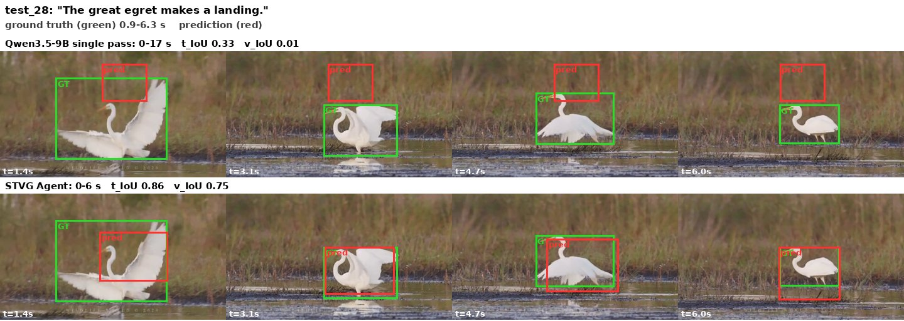

| | answer | t_IoU | v_IoU |
|---|---|---|---|
| single pass (zero-shot) | 0–17 s, a small box in the air above the bird | 0.33 | 0.01 |
| **STVG Agent** (6 steps) | 0–6 s, boxes follow the egret | **0.86** | **0.75** |

The video shows the egret landing at the start, standing and wading, and taking off at 12–17 s; the whole-video estimate
was 0.0–2.0 s. The plan read this sequence from the key frames and concluded that the landing is at the start.

| Step | What the agent did | What came back |
|---|---|---|
| 0 | `tools.Video.clip(0, 91, fps=2)` and `show(clip)`: inspect the first 3 seconds | the clip |
| 1 | `tools.SAM3.segment_video_by_text("great egret")`, then `show(egret_tube.visualize(0 / 60 / 120))` | one object over the whole video; the boxes are on the bird at 0, 2 and 4 s |
| 2 | `tools.Draw.tube(egret_tube, object=0, start_frame=0, end_frame=180)` as a clip | the tube over 0–6 s |
| 3–4 | the same clip for 3–6 s, then 4–6 s: check where the landing ends | the bird has settled by 4–6 s |
| 5 | `ReturnAnswer(egret_tube, object=0, start_frame=0, end_frame=180)` | tube with 7 boxes over 0–6 s |

### The power supply being touched (Industry, `test_158`)

*"the power supply being touched"* — a 4.6-minute recording, ground truth 258.8–270.2 s.

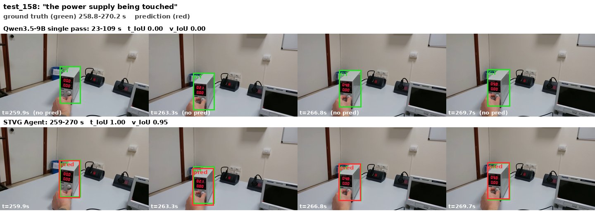

| | answer | t_IoU | v_IoU |
|---|---|---|---|
| single pass (zero-shot) | 23–109 s, no box on the power supply | 0.00 | 0.00 |
| **STVG Agent** (4 steps) | 259–270 s, boxes follow the power supply | **1.00** | **0.95** |

The whole-video estimate given to the agent after the plan was 261.7–270.5 s.

| Step | What the agent did | What came back |
|---|---|---|
| 0 | `tools.Video.clip(7860, 8100, fps=2)` and `show(clip)`: watch the estimated interval | the clip, as the next observation |
| 1 | `tools.Temporal.refine_boundary(262.5, "start", ...)` and `(270.0, "end", ...)` with a ±5 s window | start 258.5 s ("a hand enters the frame and is in contact with the power supply"), end 270.8 s |
| 2 | `tools.SAM3.segment_video_by_text("power supply", start_frame=7755, end_frame=8124)` | one object over 258.5–270.8 s |
| 3 | `ReturnAnswer(boxes, object=0, start_frame=7755, end_frame=8124)` | tube with 12 boxes over 259–270 s |

---

## 2. The most accurate runs (v_IoU ≥ 0.9)

Only **6 of the 955 test queries** reach v_IoU ≥ 0.9 (Animal 2 of 157, Industry 3 of 169, Public Security 1 of 250; none in
Sports and Surgery). In all six the agent also finds the interval (t_IoU ≥ 0.93), while the single pass of the same model
is far off in both time and space.

| Domain | Query | Ground truth | Single pass (t / v) | STVG Agent (t / v) | Steps |
|---|---|---|---|---|---|
| Animal `test_121` | A mouse repeatedly scratching itself with its hind paw. | 9.0–23.4 s | 0.62 / 0.31 | 0.93 / 0.92 | 4 |
| Animal `test_2` | The rat snake is sensing its environment. | 4.8–14.8 s | 0.82 / 0.16 | 1.00 / 0.98 | 8 |
| Industry `test_112` | the oscilloscope being touched | 0.9–5.6 s | 0.56 / 0.02 | 1.00 / 0.94 | 6 |
| Industry `test_158` | the power supply being touched | 258.8–270.2 s | 0.00 / 0.00 | 1.00 / 0.95 | 4 |
| Industry `test_168` | the oscilloscope being touched | 0.4–1.0 s | 0.20 / 0.02 | 1.00 / 0.93 | 30 |
| Public Security `test_178` | An anomalous truck visible during an event where the camera vehicle moves laterally ... and collides with another vehicle | 3.8–6.8 s | 0.30 / 0.12 | 1.00 / 0.93 | 10 |

`test_158` is shown in full in section 1 and `test_112` in section 3.

### Watch, track, check, submit — Animal, `test_121`

*"A mouse repeatedly scratching itself with its hind paw."* — ground truth 9.0–23.4 s. Single pass 0–23 s, 0.62 / 0.31;
agent **0.93 / 0.92** (4 steps).

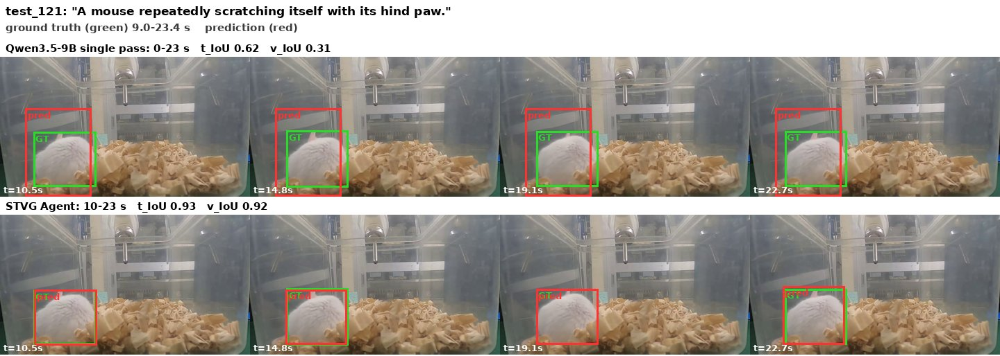

| Step | What the agent did | What came back |
|---|---|---|
| 0 | `tools.Video.clip(299, 713, fps=2)` and `show(clip)`: watch the estimated interval (10.0–23.8 s) | the clip |
| 1 | `tools.SAM3.segment_video_by_text("mouse", start_frame=300, end_frame=714)` | one object present in all 414 frames |
| 2 | `show(mouse_boxes.visualize(300))`, `(450)`, `(713)`: check the start, middle and end | boxes stay on the mouse |
| 3 | `ReturnAnswer(mouse_boxes, object=0, start_frame=..., end_frame=...)` for 10–24 s | tube with 14 boxes over 10–23 s |

### A snake the text prompt cannot find — Animal, `test_2`

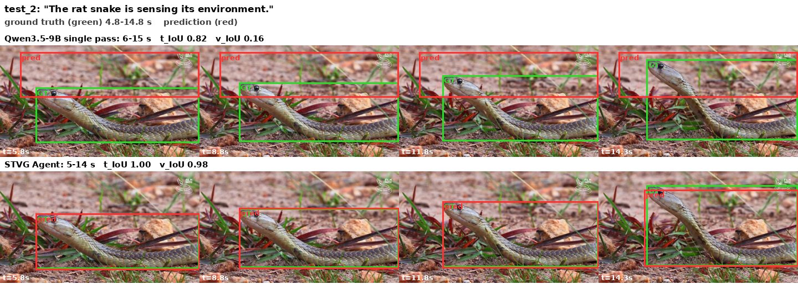

`tools.SAM3.is_object_exist` found no "rat snake" in three key frames, so the agent switched to `vlm.locate` ("the
light-colored snake on sand") on two key frames, converted the boxes to pixels, tracked the snake from them with SAM 3 and
submitted 5–14 s. The single pass has the right interval but boxes the wrong region (v_IoU 0.16).

### A very short action — Industry, `test_168`

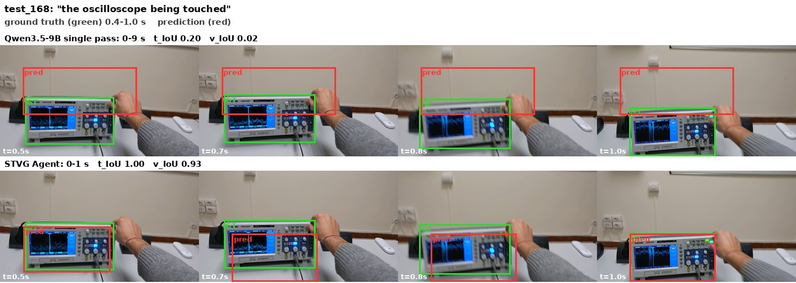

The event lasts 0.6 s. The agent tracked the oscilloscope and the hand over the 47 frames of the clip, worked out when they
touch and submitted at step 6. The short-tube check then asked it to look again; it kept replying "task completed" until the
step limit (30) and the answer did not change.

### A collision between vehicles — Public Security, `test_178`

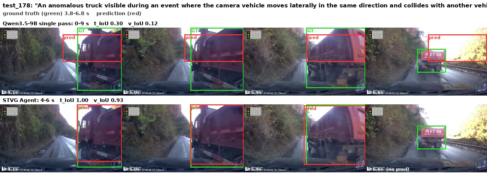

The agent tracked the "red truck" over the clip, asked the VLM when the camera vehicle and the truck come close, refined
the start (4.5 s), submitted 4.5–5.4 s and then, after checking before and after, extended the tube to 3.5–6.2 s and
submitted again (scored: 4–6 s).

---

## 3. More successful runs

### The right time, the wrong place — Animal, `test_85`

*"The hyena is displaying its defensive pose."* — ground truth 18.6–24.5 s.

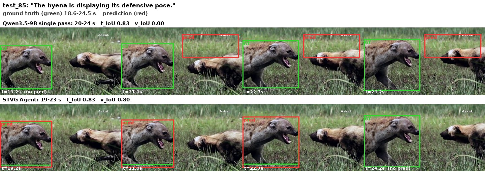

The single pass finds the time (t_IoU 0.83) but its box lies in the grass (v_IoU 0.00). The agent tracks the hyena with
SAM 3, so the box follows it (0.83 / 0.80).

| Step | What the agent did | What came back |
|---|---|---|
| 0 | watch a clip of 19–25 s (the whole-video estimate was 19.0–25.0 s) | |
| 1 | `segment_video_by_text(["hyena"], start_frame=570, end_frame=720)` | more than one object |
| 2–3 | `tools.Draw.tube(res, object=0 / 1)`: draw both candidates to see which one is the hyena | object 1 is the hyena |
| 4 | `tools.Temporal.refine_boundary` at 19.0 s (start) and 24.0 s (end) | start 18.6 s ("the scene cuts from lions to the hyena at 18.6 s"), end 24.4 s |
| 5 | submit object 1 | tube over 19–23 s (the track covers 19–24 s) |

### Falling back to a box and reusing it — Animal, `test_1`

*"The catfish is keeping still."* — a 78-second video, ground truth 74.3–77.6 s.

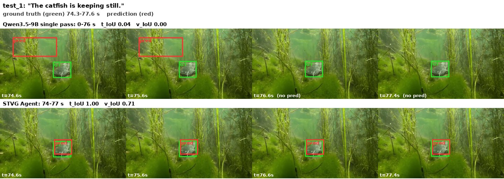

| | answer | t_IoU | v_IoU |
|---|---|---|---|
| single pass (zero-shot) | 0–76 s, a box on the water plants | 0.04 | 0.00 |
| **STVG Agent** (7 steps) | 74–77 s, one box on the fish | **1.00** | **0.71** |

The key frames show the catfish only at the end of the video; the whole-video estimate was 65.3–77.7 s.

| Step | What the agent did | What came back |
|---|---|---|
| 0 | `segment_image_by_text` on two key frames (74.7 s and 77.0 s) | no object found, and a `KeyError` in the printing code |
| 1 | `show` the two frames and a clip of 74–78 s | the catfish is lying on the bottom among plants |
| 2 | `tools.Temporal.refine_boundary(75.4, "start", ...)`, then `segment_video_by_text("catfish", ...)` | start 74.4 s ("a large catfish suddenly becomes clearly visible"); SAM 3 finds no object |
| 3 | `segment_image_by_text` again on five frames | no object |
| 4–5 | `vlm.locate` for the catfish on a key frame, convert the box to pixels, `segment_image_by_box` | a box with score 0.96 (two small errors on the way: a type error and a failed second `vlm.locate` on a frame where the fish is hidden) |
| 6 | `segment_video_by_text` finds nothing, so the agent builds the tube by reusing the 0.96 box on every frame of 74.4–77.7 s ("the catfish is stationary") and submits | tube over 74–77 s |

The text prompt does not work here; what makes the run succeed is the fallback to `vlm.locate` plus SAM 3 with a box, and
the observation that the fish does not move. This only works because the query says the fish "keeps still".

### A hand touching an oscilloscope — Industry, `test_112`

*"the oscilloscope being touched"* — ground truth 0.9–5.6 s. Single pass 1–9 s, 0.56 / 0.02. Agent **1.00 / 0.94** (6 steps).

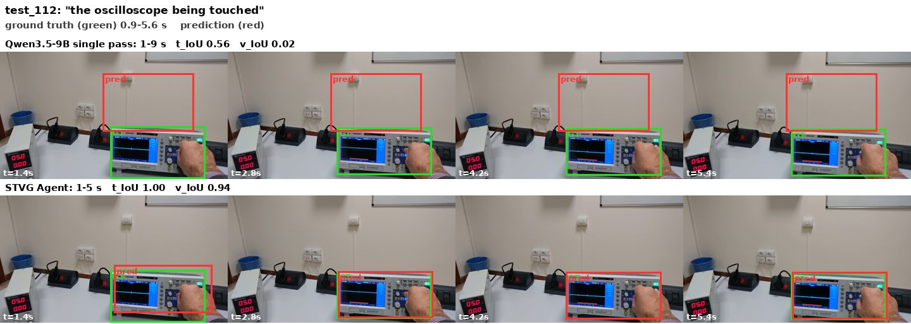

| Step | What the agent did | What came back |
|---|---|---|
| 0–1 | watch two clips at 5 fps: 0–3.3 s and 3.3–6.6 s | the agent reads the interval as about 1.1–5.5 s |
| 2 | `segment_video_by_text(["oscilloscope"], start_frame=33, end_frame=166)` | one object |
| 3 | draw the tube, then `refine_boundary(1.1, "start")` | "a hand enters from the right at 0.6 s" |
| 4 | track again over a wider window (frames 18–165) | tube 0.8–5.5 s |
| 5 | `ReturnAnswer(tube)` | tube over 1–5 s |

### Recovering from errors — Public Security, `test_131`

*"An anomalous car visible during an event where the camera vehicle turns into or crosses a road and collides with another
vehicle"* — ground truth 3.2–5.7 s. Single pass 0–7 s, 0.38 / 0.00. Agent **1.00 / 0.83** (7 steps).

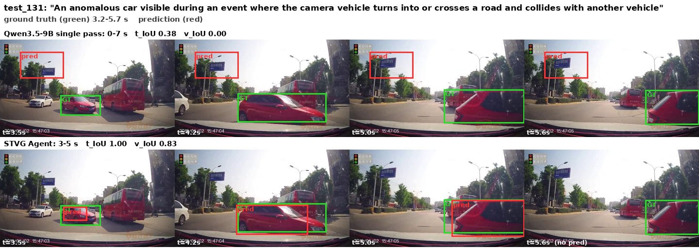

| Step | What the agent did | What came back |
|---|---|---|
| 0 | track the "red car" over the first 78 frames | one track |
| 1–2 | `refine_boundary(3.0, "start")` and `(5.0, "end")` | the red car enters the camera car's path at 3.0 s |
| 3–4 | `show` frames at 3–6 s; draw the tube on frames 30–50 | the box is on the red car |
| 5 | refine again at 10 fps, slice the track by frame range and submit | the cell raised a `KeyError` |
| 6 | read the boxes one frame at a time with `get_box(frame=..., object=0)` and submit | tube over 3–5 s |

### A long run with a re-grounding — Surgery, `test_7`

*"Own hands right during incision"* — ground truth 18.9–34.9 s. Single pass 0–65 s, 0.14 / 0.07. Agent **0.90 / 0.76**
(18 steps).

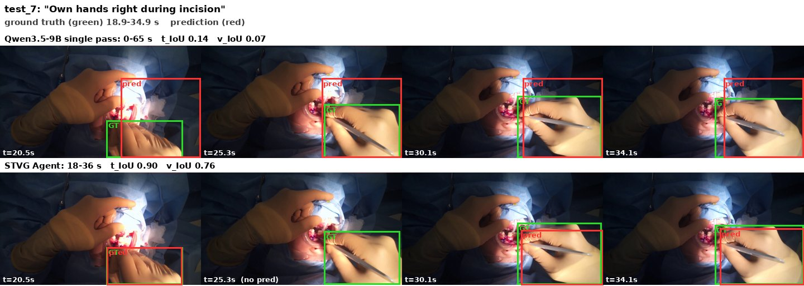

The agent watched the estimated interval (steps 0–3), then asked `vlm.locate` for the right hand (steps 4–6); the first
SAM 3 call failed on a wrong `prompt_frame_idx`, and the box it got was too large and misplaced. After locating the hand
again (steps 9–12) it switched to a SAM 3 text prompt on a key frame ("right hand of the surgeon holding a tool"), picked
the matching object, tracked from that box (steps 13–14), checked the frames just before and after the interval (15–16)
and submitted 18–36 s.

### An instrument target: rewording the prompt — Surgery, `test_182`

*"specimen bag during gallbladder packaging"* — ground truth 33.2–86.2 s. Single pass 0.65 / 0.02; agent 0.61 / **0.46**
(6 steps).

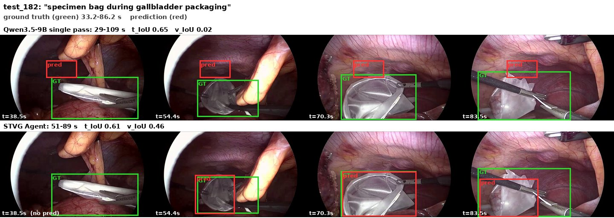

The single pass finds an interval (29–109 s) but puts its box on tissue. The agent watched the estimated interval (52–87 s)
and asked SAM 3 for "specimen bag", which detected nothing. It reworded the prompt to "transparent plastic bag" (one
object), tracked it from the middle of the interval over the window and submitted 51–89 s with boxes that follow the bag.
The interval starts late (the bag appears from 33 s), so t_IoU is 0.61.

---

## 4. More comparisons

| | |
|---|---|
| **Animal `test_92`** "The millipede is moving." (78-second video). The single pass answers 72–78 s with a small box off the animal (0.38 / 0.03); the agent 71–77 s (1.00 / 0.85) in 2 steps. | 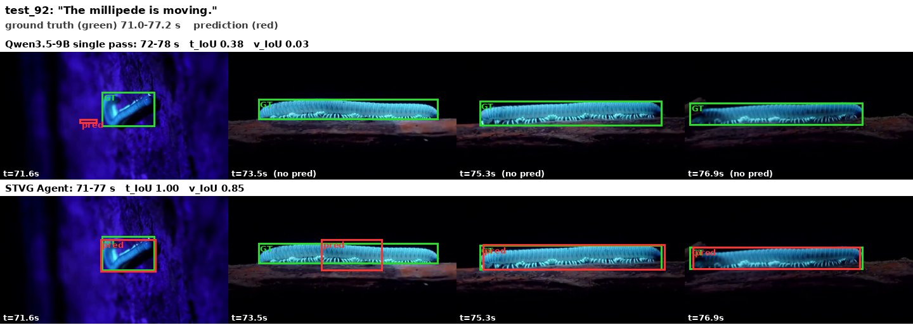 |
| **Industry `test_97`** "put screwdriver" (a 0.8 s action in a long video). The single pass answers the whole video; the agent 1.00 / 0.82 (28 steps). | 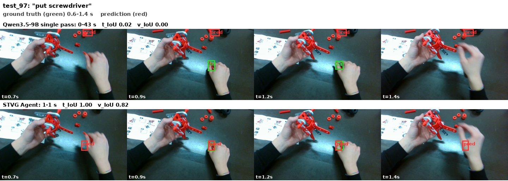 |
| **Surgery `test_102`** "Gauze during dissection". Single pass 0.09 / 0.00; agent 1.00 / 0.62. | 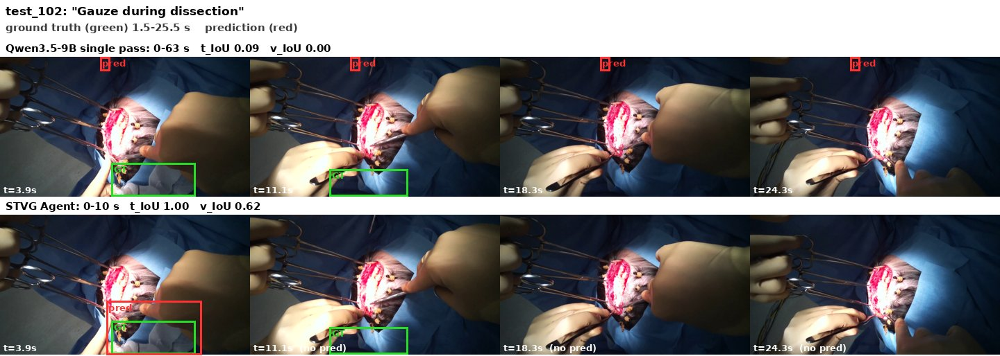 |
| **Public Security `test_166`** An anomalous car in a collision (the camera vehicle is moving ahead or waiting). Single pass 0.22 / 0.00; agent 1.00 / 0.76. | 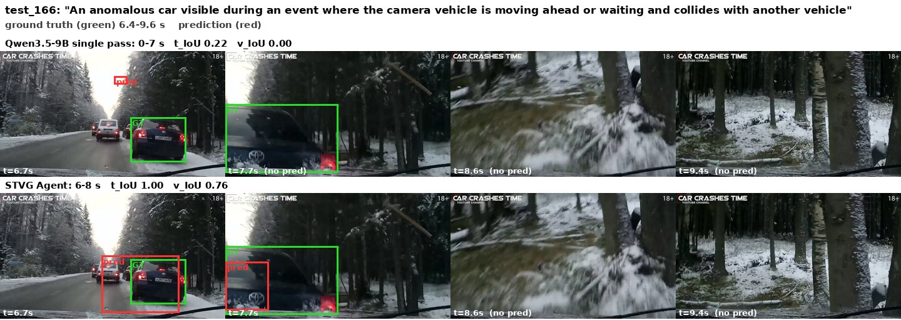 |

---

## 5. Where it fails

Sections 1–4 are successes. Below are the ways the agent fails, counted over all 955 test queries of the five domains
(one run each), with an example of each. Percentages are shares of the 955 queries unless stated otherwise.

| Failure | Queries | Share | Mean t_IoU / v_IoU |
|---|---|---|---|
| **The interval is missed** (t_IoU < 0.1) | 390 | 41% | – |
| &nbsp;&nbsp;the whole-video estimate is wrong and so is the answer | 454 | 48% | – |
| &nbsp;&nbsp;the agent drops a correct estimate | 53 | 6% | – |
| **The interval is right, the boxes are not** (t_IoU ≥ 0.5, v_IoU < 0.1) | 88 | 9% | – |
| **The step limit (30) is reached** | 34 | 3.6% | 0.17 / 0.01 |
| SAM 3 returns no object at least once | 113 | 12% | 0.25 / 0.08 |
| The answer is built from hand-written boxes | 56 | 6% | 0.18 / 0.03 |
| *For comparison: all queries* | 955 | | 0.29 / 0.14 |

The first two rows overlap with the others. The "estimate" is the whole-video "when?" call that is given to the agent
after the plan; it overlaps the ground truth (IoU ≥ 0.5) in only 209 of 949 queries (22%). When it does, the final answer
averages 0.52 / 0.29, otherwise 0.23 / 0.09.

### 5.1 The interval is missed (41%)

By domain: Animal 42%, Industry 63%, Sports 49%, Surgery 46%, Public Security 16%. Most of these are queries where the
estimate was wrong as well (454 queries, 48% of all): the event is short (see [limitation.md](limitation.md)) and the
agent finds another plausible moment. In 95 queries the agent did recover from a wrong estimate (final t_IoU ≥ 0.5).

**Animal `test_23`** — *"The bottlenose dolphin is diving."* Ground truth 3.8–4.9 s (1.1 s). The estimate was 7.0–8.2 s and
the plan guessed 0–2 s; neither is right. The agent compared both regions, tracked the dolphin, refined the boundaries
around 0–2 s and submitted 0–2 s (0.00 / 0.00). The single pass (0–8 s) misses too (0.11 / 0.00).

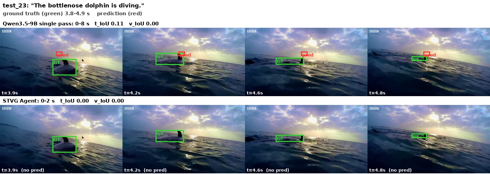

**Industry `test_1`** — *"take screw"*, ground truth 20.9–21.9 s in a long video. The agent watched five candidate clips
(5–8, 14–18, 31–33, 35–38 and 45–48 s), could not decide between them, wrote boxes by hand and submitted the last
candidate (45–47 s): 0.00 / 0.00. Short, ambiguous actions in long assembly videos are the most frequent case in Industry.

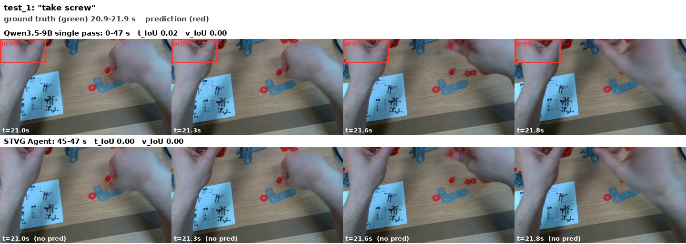

### 5.2 The agent drops a correct estimate (6%, one in four of the correct estimates)

**Surgery `test_1`** — *"Forceps during dissection"*, ground truth 23.8–45.8 s. The estimate (23–38 s) is right. The agent
tracked "forceps" in a window it computed from InputImages positions (one image per 2 s of this video), then read the same
numbers as frame numbers and as seconds, and ended with a tube over 48–58 s (0.00 / 0.00), even though the single pass
(0.28 / 0.00) had the right region.

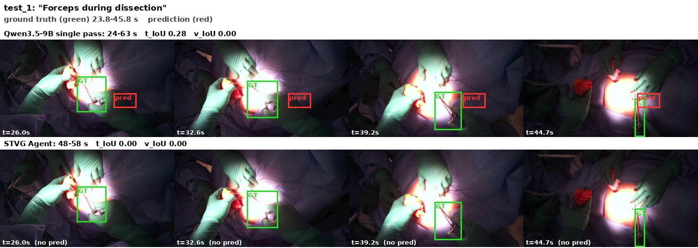

Mixing up InputImages positions, native frame numbers and seconds is the typical cause; it is worst in Surgery, whose
videos are sampled sparsely.

### 5.3 The interval is right, the boxes are not (9%)

Sports 36 queries (22% of the domain), Public Security 26, Surgery 16, Industry 10, Animal 0. In another 27 queries the
interval is right and v_IoU is only 0.1–0.3.

**Sports `test_156`** — *"A receiver catches a forward pass, and the play continues until the receiver is stopped."*
Ground truth 20.4–25.2 s. The agent finds the interval (20–26 s, t_IoU 0.86) but v_IoU is 0.00 after 30 steps: the field has
31 players, SAM 3's text and point prompts returned a box about 360 px wide, and from step 14 the agent wrote boxes by
hand instead of tracking one player.

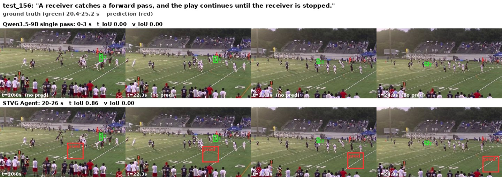

### 5.4 The step limit is reached (3.6%)

34 queries run out of the 30 steps without a submission (Animal 3, Industry 9, Sports 5, Surgery 9, Public Security 8). The
answer is then a fallback: one VLM call over the key frames, which scores 0.17 / 0.01 on average. We see two patterns.

**Re-watching clips without ever tracking — Industry `test_39`.** *"take red angled perforated bar"*, ground truth
14.8–16.3 s. The estimate (15–16 s) is right, but the agent asked for a clip of 15–20 s, then of 0–5 s, then of the whole
video, over and over for 30 steps and never reached the tracking step. The fallback answered 14–15 s (t_IoU 0.50) with a box
off the object (v_IoU 0.00).

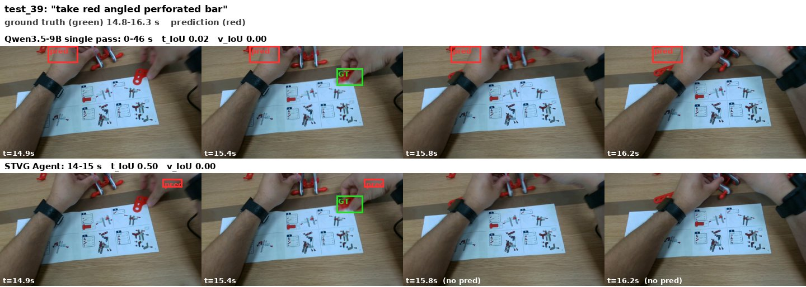

**Doubting the query and failing to submit — Public Security `test_203`.** *"An anomalous car visible during an event
where the camera vehicle turns into or crosses a road and collides with another vehicle"*, ground truth 2.8–5.2 s. The
estimate (2–6 s) is right, but the agent kept asking whether the described event happens at all, looked for a police car,
and in the end tried to submit an "empty result": `ReturnAnswer` refused it 14 times (`TypeError: ReturnAnswer expects a
non-empty dict ...`). The fallback gave one box for one second (0.00 / 0.00).

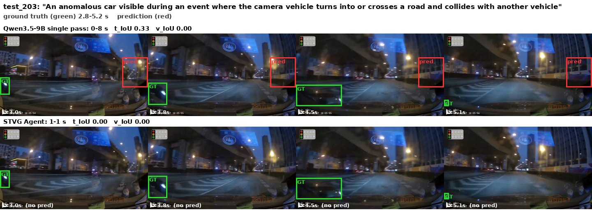

### 5.5 Code errors take the budget (the background of everything above)

- 80% of the queries (767) have at least one step that raised an error, 41% (396) have three or more; 2,638 of the 12,897
  steps (20.5%) ended in an error.
- The error types: `ValueError` 24%, `TypeError` 24%, `IndexError` 21%, `KeyError` 16%, `AttributeError` 4%, a violation
  of the code safety check 3%, `ModuleNotFoundError` 2%. Most are wrong indexing of tracks and frames, wrong argument types
  and shapes for the tools, and parsing the text a VLM returned.
- Queries without an error step average 0.35 / 0.22 (188 queries), with one or two 0.30 / 0.15 (371), with three or more
  0.25 / 0.09 (396). Hard queries produce more errors, so this is a correlation; it is also what costs steps in 5.4.
- SAM 3 returned no object at least once in 113 queries (12%; 0.25 / 0.08). The agent then falls back to `vlm.locate` and
  a box (as in `test_2` and `test_13`), or, in 56 queries (6%; 0.18 / 0.03), builds the answer from hand-written boxes
  (counted as three or more literal boxes in the submitting cell). This works when the target is still (Animal `test_1`)
  and fails in a crowd (5.3).
